# Project 5 - Secure client-data platform

**Scenario.** A small accounting firm stores tax records for several clients. Requirements:

| # | Requirement | Control used |
|---|---|---|
| R1 | Clients' data must never be reachable from the public internet | Public blob access off, firewall default Deny, **private endpoint** + private DNS |
| R2 | No shared secrets floating around | **Shared key access disabled**; Entra ID auth + **user delegation SAS** |
| R3 | Staff get only the access they need | **Custom RBAC role** (data plane only) scoped to one account |
| R4 | Mistakes and ransomware must be recoverable | Versioning, soft delete, optional **time-based immutability** |
| R5 | A copy lives in a second account | **Object replication** A -> C |
| R6 | Old records cost less over time | **Lifecycle management** (cool, archive, delete) |
| R7 | Every access is auditable and costs are visible | **Diagnostic settings** -> Log Analytics (KQL), budget, tags |

## Architecture

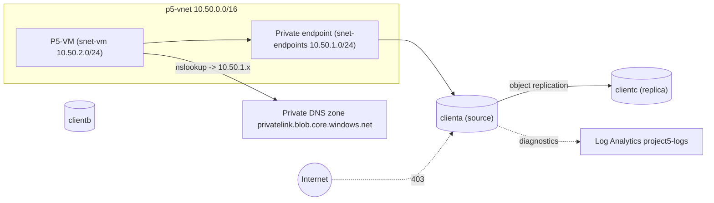

## Deploy

```bash
cd scripts
export P5_VM_PASSWORD='use-a-strong-throwaway-password'
./deploy.sh Project_5 eastus
```
Then (optional, second pass) copy outputs `replicationPolicyId` and `replicationRuleId` into `infra/main.bicepparam` and redeploy to create the source-side replication policy. Governance (custom role + policy initiative) is separate: `az deployment sub create -l eastus -f infra/subscription-governance.bicep -p targetResourceGroup=Project_5`.

Order matters when building by hand: network and DNS first, then storage accounts, then private endpoint (so DNS zone group registers the record), then data-protection features, replication last (needs versioning + change feed first), then logging.

## Prove it
See [scripts/tests.md](scripts/tests.md).

## Things that go wrong
- **Replication won't create:** versioning must be on for source and destination, change feed on the source.
- **Portal can't list blobs:** shared key is off, so the portal needs your Entra role (data role, not just Reader) and your IP/VNet allowed.
- **Private endpoint resolves to a public IP:** DNS zone not linked to the VNet, or the zone group is missing.
- **Can't delete the resource group:** an immutability policy or lock is still in place.
- **VM size unavailable:** change `vmSize` or region; check quota.

## Cost
Storage and DNS cost cents. The VM, public IP and private endpoint are the main costs: deallocate or delete the VM when not testing.

## Folder map
- `infra/` clean, parameterised Bicep (`main.bicep`) plus subscription-scope governance
- `reference/` sanitised export of the original portal-built lab (compiles, but is a snapshot, not a clean template)
- `scripts/` role JSON, lifecycle JSON, KQL, tests, deploy script
- `images/` put redacted screenshots here

## Exam mapping (AZ-104)
Storage: redundancy, access methods, firewall vs private endpoint, lifecycle, versioning, soft delete, object replication. Identity: custom roles, RBAC scope. Governance: Policy initiatives, tags, budgets. Monitoring: diagnostic settings, Log Analytics, KQL.

## Screenshots

Identifiers are redacted. Numbers in brackets map to the requirements table.

**01. Custom role "Client Blob Editor": control-plane actions vs data actions (R3)**

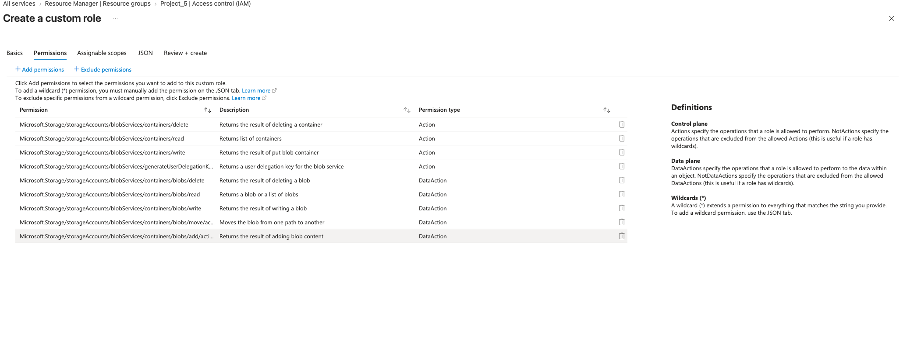

**02. Role assignments on the resource group: who gets which role, at which scope (R3)**

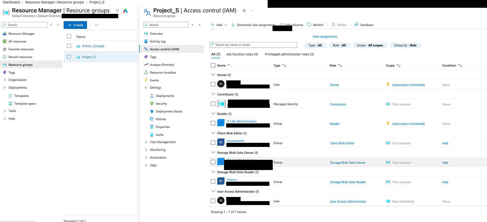

**03. Policy initiative: the built-in policies grouped into one set**

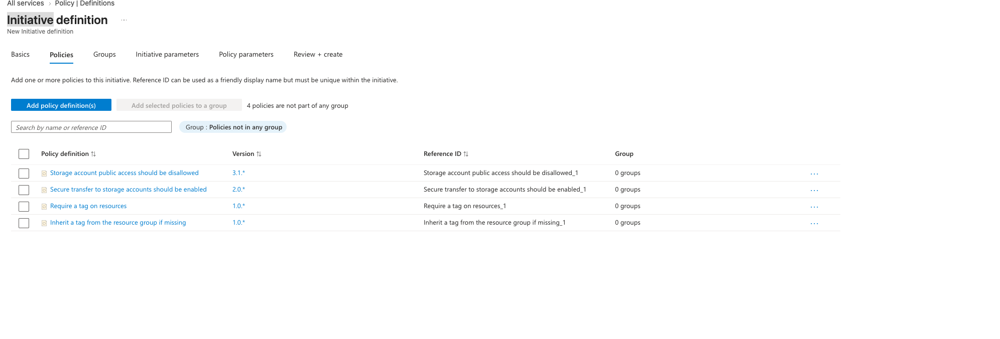

**04. Initiative assigned at the Project_5 resource group scope**

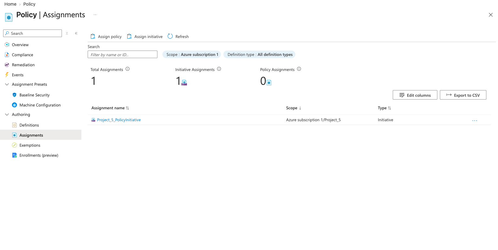

**05. Storage account properties: shared key disabled, anonymous access disabled, TLS 1.2, soft delete, versioning (R1, R2, R4)**

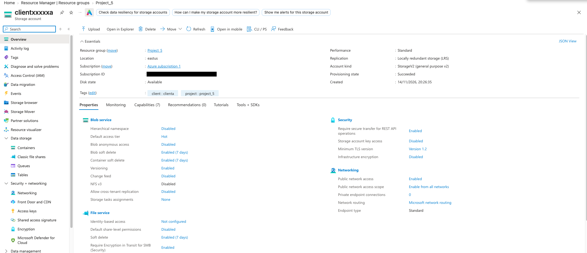

**06. Firewall: selected networks only, plus an IP rule and a service-endpoint subnet (R1)**

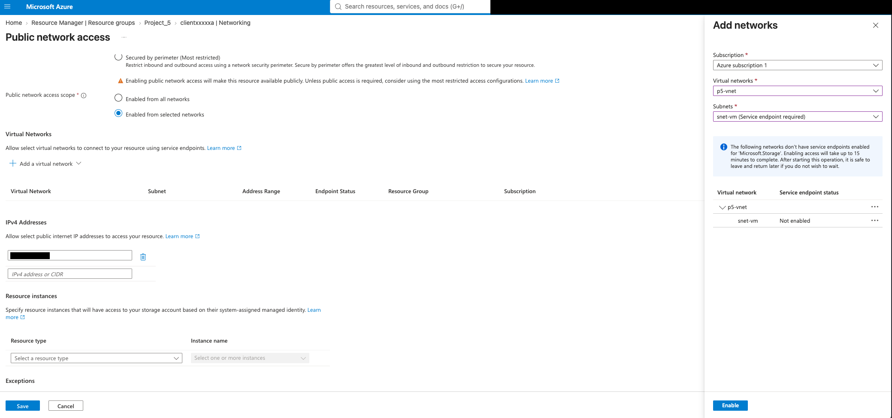

**07. Private DNS zone holds an A record pointing at the private endpoint IP (R1)**

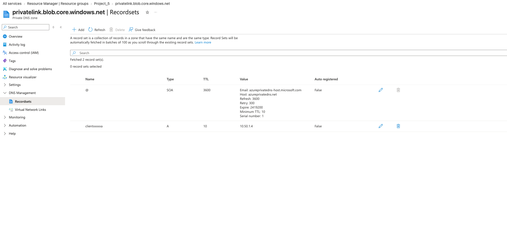

**08. From the VM, the storage name resolves to the private 10.50.x address via privatelink (R1)**

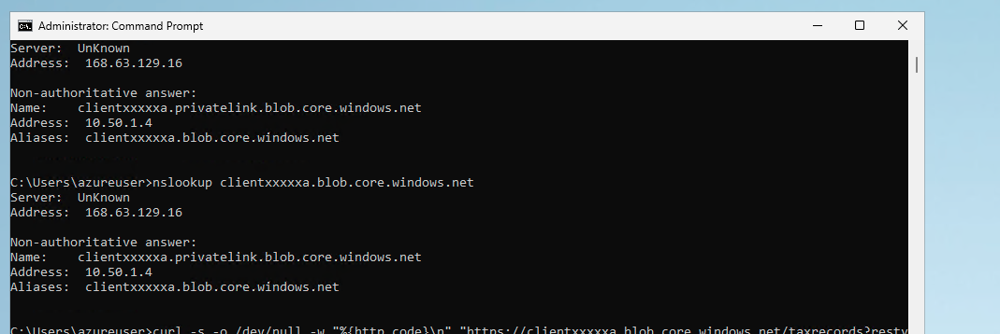

**09. From the public internet the name resolves to a public IP and the request is refused with 403 (R1)**

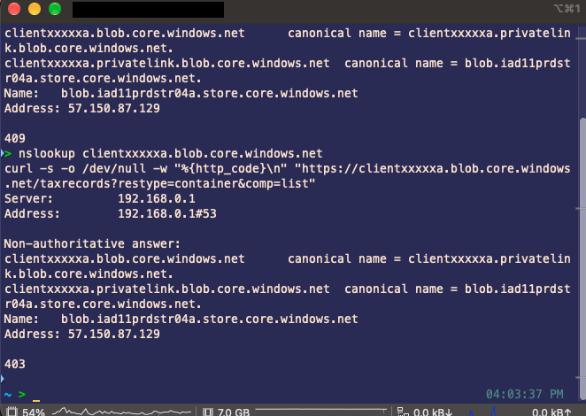

**10. Object replication rule: client A taxrecords to client C taxrecords-replica (R5)**

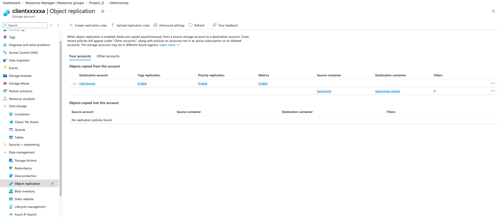

**11. Lifecycle management rule list (R6)**

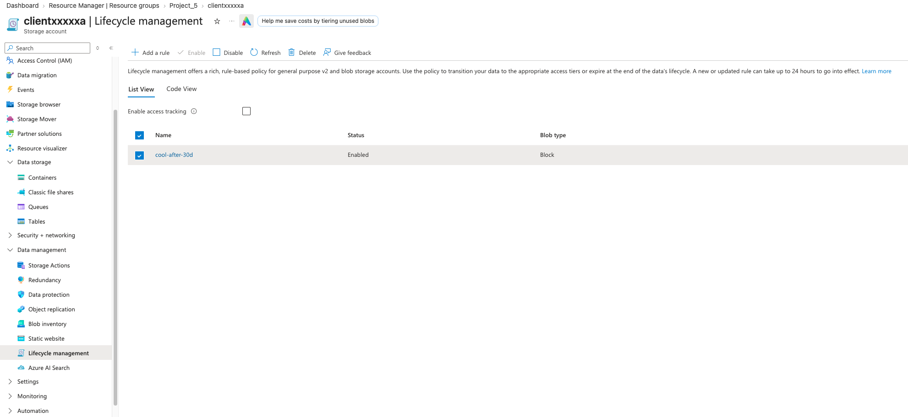

**12. Time-based retention (immutability) policy, unlocked (R4)**

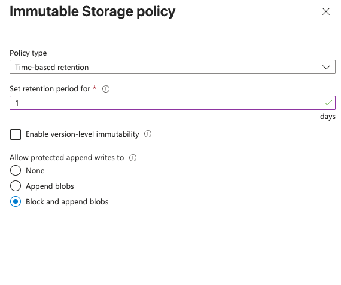

**13. Deleting a protected blob fails: immutable due to a policy (R4)**

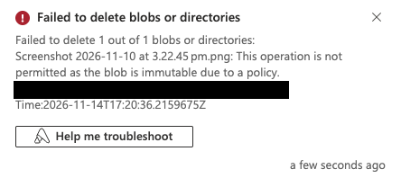

**14. Signed in as the accountant: sees containers allowed by the custom role (R3)**

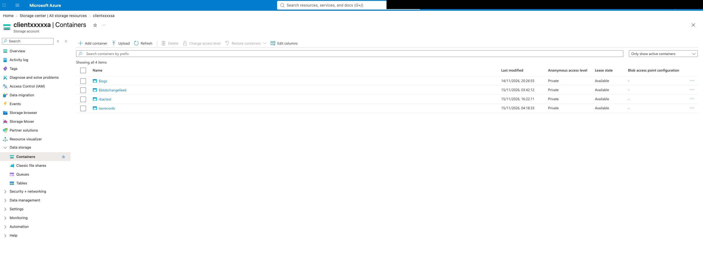

**15. Signed in as the intern: delete is refused, no data-plane delete permission (R3)**

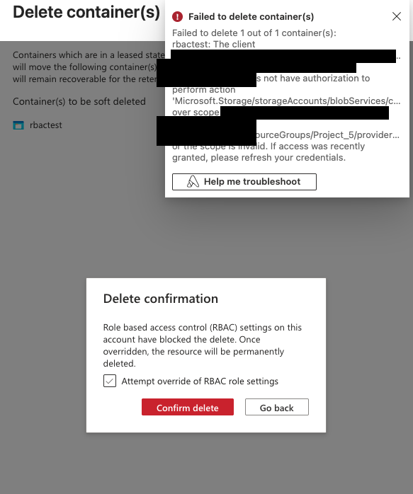

**16. KQL in Log Analytics: blob operations with caller IP (R7; IPs redacted)**

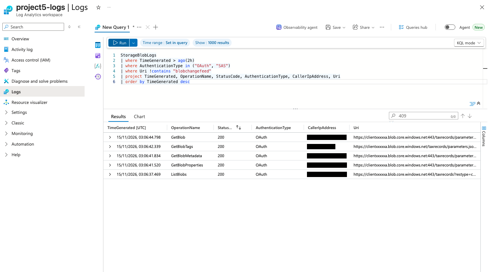

**17. Final inventory of resources in the resource group (owner tag redacted)**

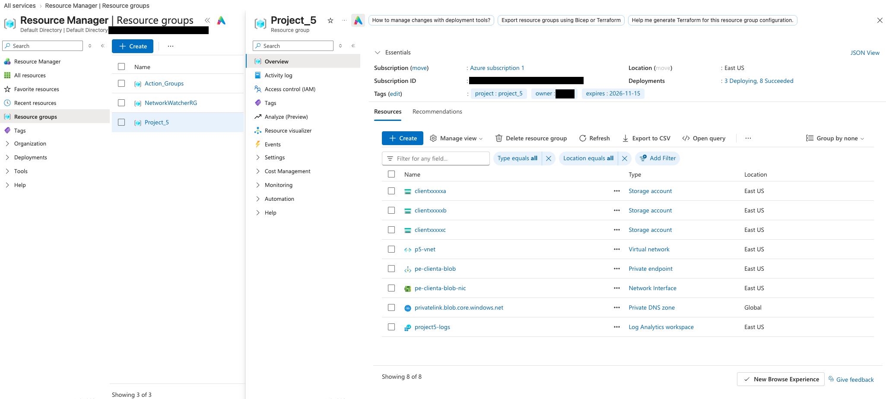

